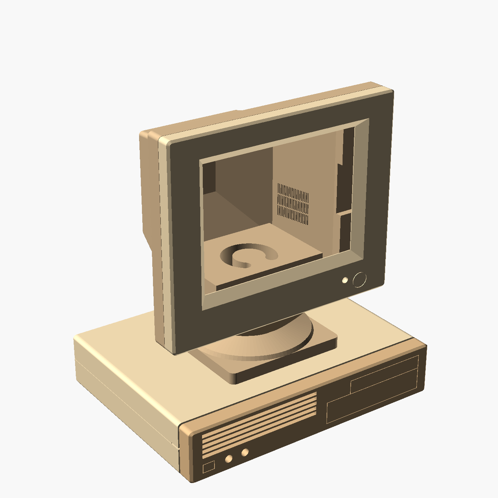
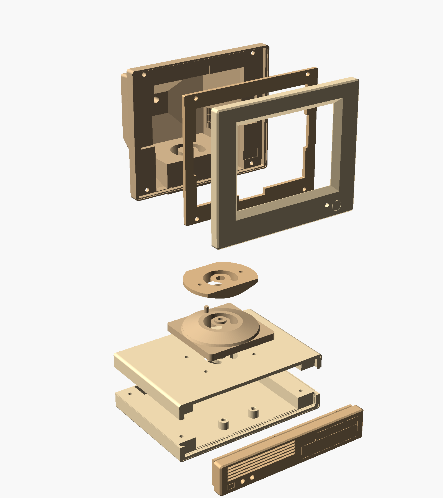

# Retro TV V20

Kleines Retro-Monitorgehäuse für ein 4,2-Zoll-E-Paper-Display auf einem Desktop-Sockel. V20 enthält jedes Druckteil als eigene STL und PNG-Vorschau.

## Vorschau

## Dateien

| Bauteil | Druckdatei | Vorschau |
| --- | --- | --- | --- |
| Monitorblende | [front.stl](front.stl) | [PNG](front.png) |
| Monitor-Rückgehäuse mit geschlossenen Kabeltaschen | [rueckgehaeuse.stl](rueckgehaeuse.stl) | [PNG](rueckgehaeuse.png) |
| Display-Haltering | [displayhalter.stl](displayhalter.stl) | [PNG](displayhalter.png) |
| Unterer Standfuß | [stand_unterteil.stl](stand_unterteil.stl) | [PNG](stand_unterteil.png) |
| Oberer Monitor-Drehteller | [monitor_drehteller.stl](monitor_drehteller.stl) | [PNG](monitor_drehteller.png) |
| Computer-Frontblende | [sockelfront.stl](sockelfront.stl) | [PNG](sockelfront.png) |
| Computer-Oberschale | [sockeldeckel.stl](sockeldeckel.stl) | [PNG](sockeldeckel.png) |
| Computer-Unterschale | [bodenplatte.stl](bodenplatte.stl) | [PNG](bodenplatte.png) |
| Gewindeeinsatz-Passprobe | [STL](Gewindeeinsatz_Passprobe.stl) | [PNG](Gewindeeinsatz_Passprobe.png) |

## Display und Befestigung

| Maß | Wert |
| --- | --- |
| Platinenaußenmaß | 103 × 78,5 mm |
| Gesamtdicke mit Display | 3,42 mm |
| Displaydicke | 1,6 mm |
| Aktive Bildfläche | 84,8 × 63,6 mm |
| Untere Platinenkante bis aktive Bildfläche | 10,5 mm |
| M3-Gewindeeinsatz: Länge | 5,7 mm |
| M3-Gewindeeinsatz: Außendurchmesser | 4,28 mm |
| Standard-Pilotbohrung | Ø 4,0 mm, 6,0 mm tief |

Die asymmetrische Lage der aktiven Bildfläche ist in der Monitorblende berücksichtigt. Die geschlossenen Kabeltaschen des Rückgehäuses behalten 2 mm Außenwand über den Taschen.

Die zentrale Gelenkachse verwendet **M4**. Zwei Befestigungen verbinden den oberen Drehteller mit dem Monitor; vier Befestigungen verbinden den unteren Standfuß mit dem Computerdeckel. Der Computerdeckel wird über vier Schrauben von unten befestigt.

## Drucken und montieren

1. Zuerst die Gewindeeinsatz-Passprobe drucken. Sie enthält Bohrungen mit Ø **3,9 / 4,0 / 4,1 mm** zum Abstimmen auf Drucker, Material und Einsatz.
2. Die acht Hauptteile im Slicer öffnen. Die gelieferten STL-Dateien liegen bereits auf Z = 0 in der vorgesehenen Drucklage. Überhänge, Brücken und gegebenenfalls nötige Stützen in der Schichtvorschau prüfen; es wurde kein konkretes Druckprofil validiert.
3. Gewindeeinsätze in die vorgesehenen Aufnahmen einsetzen. Befestigungs- und Kabelfreiraum vor dem endgültigen Zusammenbau prüfen.
4. Unteren Standfuß von der Innenseite des Computerdeckels befestigen. Oberen Drehteller mit dem Monitorboden verbinden und das Gelenk mit der zentralen M4-Verbindung zusammenfügen. Die Verbindung so einstellen, dass das Gelenk beweglich bleibt.
5. Kabel durch die bogenförmigen Öffnungen führen. Bewegungsreserve lassen und beide Drehrichtungen prüfen.
6. Display in die Monitoraufnahme einsetzen, Haltering und Rückgehäuse montieren. Kabel dürfen dabei nicht zwischen den Gehäuseteilen eingeklemmt werden.
7. Elektronik auf den Bodenhaltern befestigen, Computer-Frontblende einsetzen und die beiden Schalen mit den vier Schrauben von unten verbinden.

Schraubenlängen und Klemmung anhand der tatsächlich verwendeten Schraubenköpfe, Unterlegscheiben und Einsätze kontrollieren. Die Explosionszeichnung zeigt die Zuordnung der Teile; sie enthält keine Schrauben oder Elektronik.
